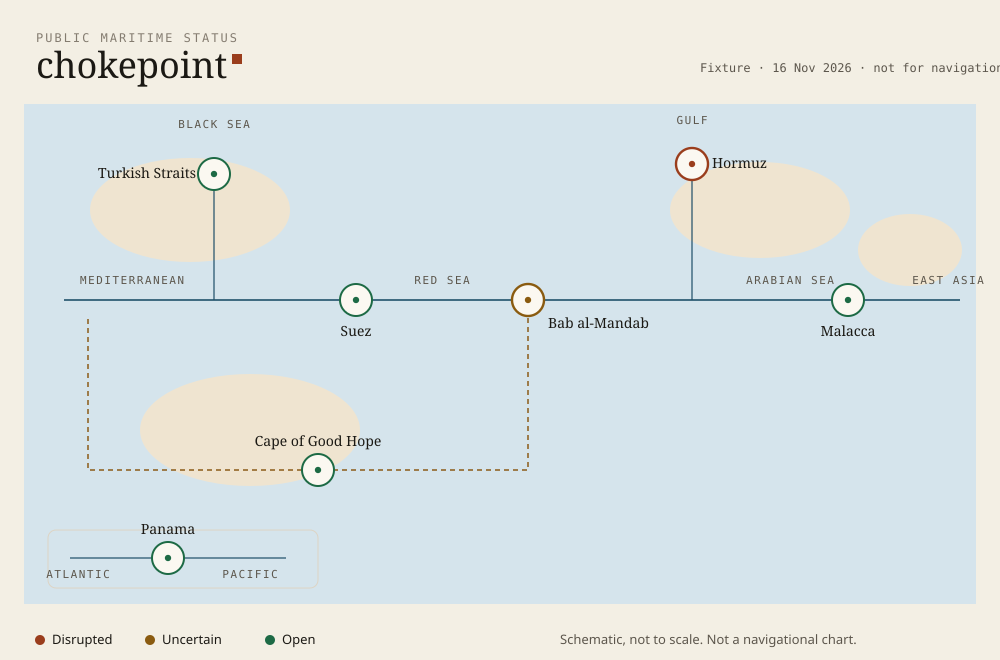

# chokepoint

Public status for the straits and canals that carry oil, gas, and containers — with the sources left in view.

On 16 November 2026, open reporting described tanker fires in the Strait of Hormuz and a withdrawal from positions around Bab al-Mandab. This repository starts from that week, and it says when you are looking at a fixture.

[](https://github.com/tz0127302-cell/chokepoint/blob/main/LICENSE)
[](https://github.com/tz0127302-cell/chokepoint/blob/main/package.json)
[](https://github.com/tz0127302-cell/chokepoint/blob/main/tsconfig.web.json)
[](https://github.com/tz0127302-cell/chokepoint/actions/workflows/ci.yml)



## This week’s fixture

The bundled snapshot is a reading of public reporting, not a verification and not a measurement of oil flows. Accounts of the Hormuz fires do not agree on the cause or the number of ships.

| Passage | Status | Why the fixture says so |
| --- | --- | --- |
| Strait of Hormuz | Disrupted | AP, ABC News, and Al Arabiya reported tanker fires on 16 November 2026. UKMTO’s alert, as carried by ABC, described a projectile and an engine-room fire. Iranian statements, as carried by the same outlets, described naval mines. |
| Bab al-Mandab | Uncertain | Reports on 15–16 November said government-aligned forces withdrew from overlooking positions, including Perim Island. Reporting did not agree on whether ordinary commercial transit had stopped. |
| Suez Canal | Open | The Suez Canal Authority’s news index listed lines returning, including a 15 November item that ONE had returned. No closure notice is in the snapshot. |
| Panama Canal | Open | No closure notice is in the snapshot. |
| Strait of Malacca | Open | No closure notice is in the snapshot. |
| Turkish Straits | Open | No closure notice is in the snapshot. |
| Cape of Good Hope | Open | The long alternative around southern Africa. It does not bypass Hormuz. |

## Disclaimer

Unofficial digest of public reporting and published statistics. Not navigational, operational, or financial advice. Not a government, military, or industry notice.

There is no ship tracking, no incident map, and no threat score. The diagram is an original schematic. It is not a chart and not for navigation. Read the linked reports, and read the canal authorities, before you treat any of this as current.

## Quickstart

This package is not published to npm. Clone the repository and install from that checkout. Node 20 or newer.

```bash
git clone https://github.com/tz0127302-cell/chokepoint.git
cd chokepoint
npm install
npm test
npm run dev
```

The dashboard is at <http://127.0.0.1:4317>. The first screen is the bundled **Fixture snapshot** dated 16 November 2026, including when a live feed fails. That date is the fixture, not a live reading. The page keeps the fixture label until you refresh feeds on your own machine.

```bash
npm run build
npm start
```

`npm start` builds if it needs to, then serves the production app and the local API at <http://127.0.0.1:4318>.

```bash
npm run chokepoint -- list
npm run chokepoint -- status hormuz
npm run chokepoint -- news --passage bab-al-mandab
npm run chokepoint -- update
npm run chokepoint -- list --json
```

Those commands run from this checkout. They do not download a package from the npm registry. Add `--json` for machine-readable output and `--fixture` to ignore any local live cache and stay on the 16 November 2026 fixture.

```text
chokepoint 0.1.0  ·  fixture  ·  snapshot 16 Nov 2026

ID                PASSAGE                 STATUS        UPDATED
hormuz            Strait of Hormuz        disrupted     16 Nov 2026
bab-al-mandab     Bab al-Mandab           uncertain     16 Nov 2026
suez              Suez Canal              open          16 Nov 2026
panama            Panama Canal            open          16 Nov 2026
malacca           Strait of Malacca       open          16 Nov 2026
turkish           Turkish Straits         open          16 Nov 2026
cape              Cape of Good Hope       open          16 Nov 2026
```

## What you are looking at

| Mode | Meaning |
| --- | --- |
| Fixture snapshot | `data/snapshot.json` only. This is the offline default. |
| Fixture + live feeds | The fixture, plus headlines from the local cache that name a tracked passage. |

`chokepoint update` and the **Refresh feeds** button fetch only the URLs in [`data/feeds.json`](data/feeds.json). The request runs on your machine. The browser does not call news sites. Fonts are bundled. A feed that fails keeps its previous cache and is marked stale. If every feed fails, the fixture remains.

GDELT DOC is implemented and **off**. It needs no key. Turn it on in `data/feeds.json` only if you accept GDELT’s terms. Results are headlines and links.

The Suez Canal Authority and the Panama Canal Authority are linked. Their HTML is not scraped.

## Status words

There are three: **open**, **disrupted**, **uncertain**. No score.

- Live headlines can raise a status when they match disruption or uncertainty language.
- They can lower a status only one step, and only on resumption language with no disruption language. One resumption headline does not move disrupted to open.
- Headlines older than 14 days stay on screen and do not move status.
- Ships using the Cape do not mark the Cape as disrupted.
- The screen is a keyword list. It will misfire. The headline is there so a person can overrule it.

The methodology page in the app is the long version. Volume estimates are dated public figures, mostly EIA through the first half of 2025 and UNCTAD for 2023. They are not a reading of flows on 16 November 2026.

## Sources

Oil volumes: [EIA, World Oil Transit Chokepoints](https://www.eia.gov/international/content/analysis/special_topics/world_oil_transit_chokepoints/) (table through 1H 2025; EIA cites the February 2026 Short-Term Energy Outlook and tanker-tracking analysis). LNG through Hormuz: [IEA](https://www.iea.org/about/oil-security-and-emergency-response/strait-of-hormuz). Trade and container shares: [UNCTAD, Review of Maritime Transport 2024](https://unctad.org/system/files/official-document/rmt2024_en.pdf) and, for Panama, [UNCTAD’s February 2024 brief](https://unctad.org/system/files/official-document/osginf2024d2_en.pdf). Where those figures differ, both are shown.

Default feeds, all public, none requiring a key:

| Publisher | Feed |
| --- | --- |
| BBC News | <https://feeds.bbci.co.uk/news/world/rss.xml> |
| The Guardian | <https://www.theguardian.com/world/rss> |
| Al Jazeera | <https://www.aljazeera.com/xml/rss/all.xml> |
| UN News | <https://news.un.org/feed/subscribe/en/news/all/rss.xml> |
| DW | <https://rss.dw.com/xml/rss-en-all> |

RSS 2.0 and Atom are parsed. RSS 1.0 is not. Headlines that do not name a tracked passage are dropped.

## Ethics

This is a reading list for journalists, developers, analysts, and anyone trying to follow public reporting. It is not operational guidance for a ship, not a trading signal, and not an official notice.

Do not add AIS, vessel dossiers, or coordinates. Do not paste full articles into the snapshot. Publisher names are for attribution. Trademarks belong to their owners.

There is no account and no analytics. The theme choice stays in `localStorage` on your machine.

## Layout

```text
src/lib        status rules, feed parsing, the passage catalog
src/cli        chokepoint list | status | news | update
src/server     local API, feed cache, static server
src/web        dashboard
data           snapshot.json and feeds.json
```

`data/cache/` is created by `update` and is not part of the git history.

## Develop

See [CONTRIBUTING.md](CONTRIBUTING.md). Tests cover parsing, the status rules, the fixture, the CLI, and a static render of the dashboard. GitHub Actions runs `npm test` and `npm run build`.

```bash
npm test
npm run build
```

## 中文简介

chokepoint 是一个开源的海上咽喉通道公开信息看板和命令行工具，汇总霍尔木兹海峡、曼德海峡、苏伊士运河、巴拿马运河、马六甲海峡、土耳其海峡，以及好望角替代航线。

2026 年 11 月 16 日的公开报道描述了霍尔木兹海峡油轮起火，以及曼德海峡一带阵地变化。仓库内置的是这一天的离线快照（Fixture snapshot），不是实时数据。页面会标明快照和后来在本机刷新的公开来源。数据来自公开报道和已发表的统计，不是航行、作业或投资建议，也不是政府或行业通告。源码安装：`git clone https://github.com/tz0127302-cell/chokepoint.git`，未发布到 npm。

## License

[MIT](LICENSE). Copyright (c) 2026 chokepoint contributors.
